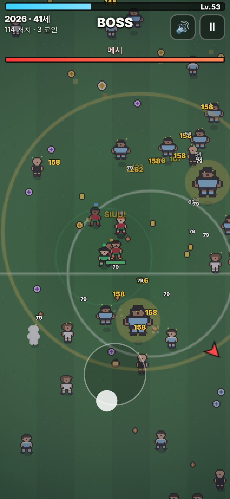

# ronaldo-survivors
호날두 서바이버즈 - 도트 뱀서라이크 (비공식 팬 패러디)

데뷔(2002, 17세)부터 2026년까지 한 해 한 스테이지. 자동 공격, 동료 모으기, 연도별 감독 카드, 날두 진화, 최종 보스 메시.

- 플레이: `index.html`을 더블클릭하거나 GitHub Pages(저장소 루트)로 열기. 빌드·서버·CDN 필요 없음.
- 조작: 화면을 누르고 끌기(폰) / WASD·방향키(PC). 공격은 자동.
- 테스트: `npm test` (Node 18+, 의존성 없음)
- 밸런스 시뮬: `node tools/sim.js`
- 스크린샷: `node tools/screenshots.js` (Playwright 필요) → `docs/screenshots/`
- 설계 문서: [docs/DESIGN.md](docs/DESIGN.md)

실제 구단·선수·감독과 무관한 비상업 팬 패러디입니다. 구단 로고를 쓰지 않으며 이름은 패러디입니다.
